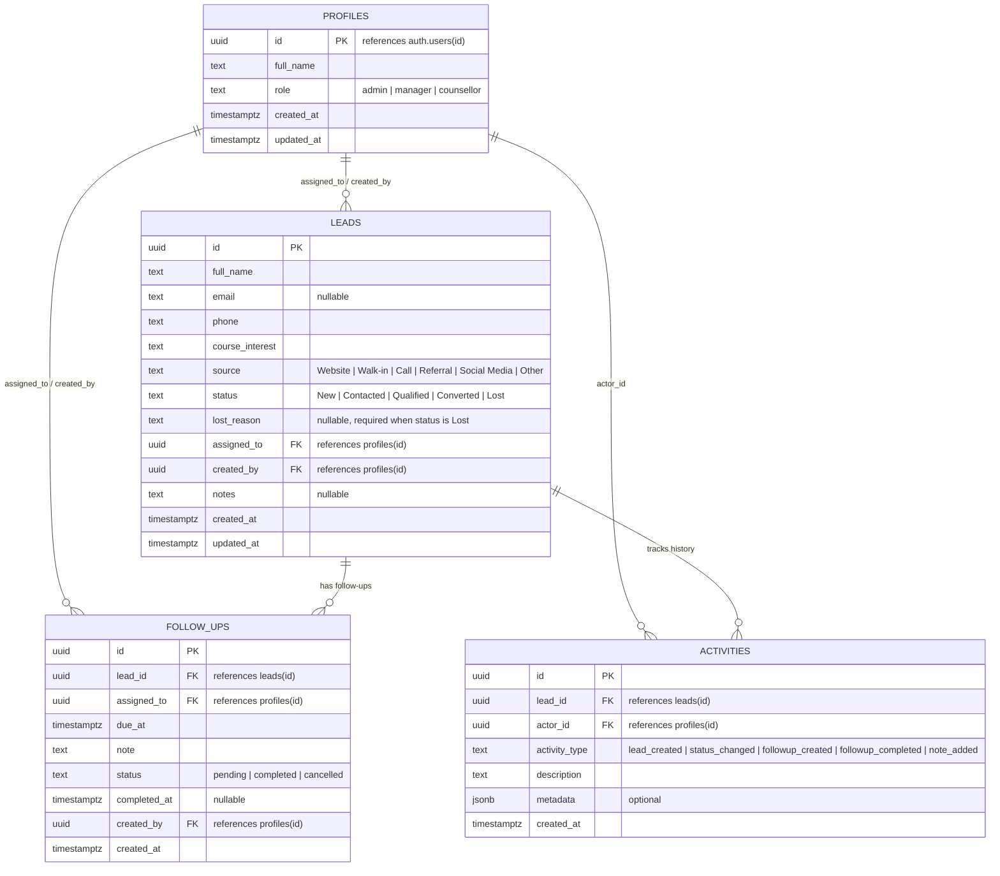

# BrightPath CRM — Master Execution Plan & Feature Roadmap

**Project:** BrightPath CRM (Student Enquiry & Admissions Management for BrightPath Academy)  
**Primary Stack:** React 18/19 + TypeScript + Vite • Supabase (PostgreSQL + Auth + RLS) • Git / GitHub • Vercel  
**Specification Document:** `BrightPath_CRM_Full_Master_Build_Prompt.pdf`  
**Development Methodology:** Incremental Feature-Driven Development. Each phase covers one distinct feature or architecture milestone. Each feature is developed, tested locally, verified against acceptance criteria, committed and deployed to Vercel, tested live in the browser, and then approved before proceeding to the next.

---

## 1. Feature Delivery Lifecycle (For Every Phase)

Every single phase follows this strict 6-step loop:

1. **Feature Development**: Implement only the components, services, and logic scoped for that specific phase.
2. **Local Testing**: Run TypeScript compilation checks (`tsc --noEmit`), Vite production build (`npm run build`), and verify component functionality.
3. **Acceptance Verification**: Verify against explicit acceptance criteria from the master specification.
4. **Git Commit & Deployment**: Commit clean staged changes with descriptive messages, push to GitHub `main`, and trigger the Vercel deployment.
5. **Live Smoke Test**: Inspect build logs and test the live Vercel URL in the browser.
6. **Approval Checkpoint**: Present verified changes and results to the user; await user approval before editing files in the next phase.

---

## 2. Phase Execution Matrix & Tracking

| Phase | Description | Deliverables | Verification Gateway | Status |
| :---: | :--- | :--- | :--- | :---: |
| **0** | Baseline & Account Readiness Check | Status report, account checklist | Clean repo, Node/npm verified | **COMPLETED** |
| **1** | Scaffolding, Design System & Layout Shell | React+TS+Vite, CSS tokens, Sidebar, Route shells | Clean build, responsive navigation | **COMPLETED** |
| **2** | Supabase Client & Environment Safety | `supabaseClient.ts`, `.env.example`, Error banner | Verified missing env UI test & client init | **COMPLETED** |
| **3** | Database Migrations, RLS & Seed Data | 3 SQL migrations, TypeScript schema types | Migrations created & TS types verified | **COMPLETED** |
| **4** | Auth, Profile Lifecycle & Role Access | Sign-in modal, session restore, role guards | AuthContext, login/signup & role switching verified | **COMPLETED** |
| **5** | Lead Intake, Directory, Search & Filters | Lead table, filters bar, create modal with validation | Lead creation persists to Supabase | **READY TO START** |
| **6** | Status Lifecycle & Activity Timeline | Lead drawer, lost reason modal, activity log | Status updates, activity audit logged | PENDING |
| **7** | Follow-ups & Overdue Engine | Scheduler, overdue tabs, complete action | Overdue logic & completion verified | PENDING |
| **8** | Real-Time Dashboard & Reconciled KPIs | KPI cards, pipeline charts, overdue widget | KPIs reconcile with list queries | PENDING |
| **9** | Accessibility, Mobile Polish & Error States | A11y polish, skeletons, offline banner | Keyboard navigation, 375px mobile test | PENDING |
| **10** | Production Build Audit & Handover | Clean build, `README.md`, handover report | `npm run build` clean, live smoke test | PENDING |

---

## 3. Data Model Architecture

All timestamps use `timestamptz`. Primary keys use `UUID` (`gen_random_uuid()`).



---

## 4. Detailed Phase Specifications

### Phase 0: Baseline & Account Readiness Check
* **Objective:** Verify environment compatibility, toolchain, and external service accounts without altering project code.
* **Scope:**
  * Local toolchain: Node.js `v24.21.0`, npm `11.19.0`.
  * Remote repository: `https://github.com/Roheethrana/brightpath-crm.git` on branch `main`.
  * Verify account access: Supabase dashboard and Vercel dashboard.
* **Acceptance Criteria:**
  - [x] Full master prompt specification extracted and analyzed.
  - [x] Node and npm verified.
  - [x] Git remote identified and clean working tree confirmed.
  - [x] Zero application code touched before approval.

---

### Phase 1: Application Foundation, Design System & Layout Shell
* **Objective:** Scaffold clean React + TypeScript + Vite project with design system tokens and responsive navigation shell.
* **Scope & Implementation:**
  * Scaffold Vite project structure (`package.json`, `tsconfig.json`, `vite.config.ts`, `index.html`).
  * Install dependencies: `lucide-react`, `date-fns`.
  * Configure `src/index.css` design system:
    * Palette: Primary navy (`#0F172A`), brand blue (`#2563EB`), neutral slates, semantic status colors.
    * Base tokens: Card styles, button variants (primary, secondary, danger, ghost), inputs, and status badges.
  * Implement base layout shell (`src/components/layout/`):
    * Desktop sidebar navigation (Dashboard, Leads, Follow-ups, Settings) with toggle collapse.
    * Responsive mobile topbar with slide-out navigation drawer.
    * Top header bar with page title, breadcrumb, and user role placeholder.
  * Stub page views: `DashboardPage`, `LeadsPage`, `FollowupsPage`, `SettingsPage`.
* **Testing & Verification:**
  * `npm run build` compiles with zero errors.
  * Navigation switches cleanly between views.
  * Viewport responsive check: 1440px desktop, 768px tablet, 375px mobile.
* **Deployment Step:**
  * Commit: `feat: scaffold react-ts-vite foundation with design system and navigation shell`.
  * Push to GitHub `main` $\rightarrow$ verify initial Vercel build $\rightarrow$ test live shell URL.
* **Acceptance Criteria:**
  - [ ] App starts locally with `npm run dev`.
  - [ ] Production build succeeds with `npm run build`.
  - [ ] Navigation shell responds smoothly across screen sizes.
  - [ ] Live Vercel deployment renders navigation shell without console errors.

---

### Phase 2: Supabase Client, Environment Validation & Safety Screen
* **Objective:** Set up typed database client, strict `.gitignore` rules, and an actionable configuration safety screen.
* **Scope & Implementation:**
  * Install `@supabase/supabase-js`.
  * Create `.env.example` with standard public key placeholders:
    ```env
    VITE_SUPABASE_URL=https://your-project-id.supabase.co
    VITE_SUPABASE_ANON_KEY=your-anon-public-client-key
    ```
  * Update `.gitignore` to strictly exclude `.env`, `.env.local`, and credential files.
  * Create `src/lib/supabaseClient.ts`:
    * Validate presence and structure of `VITE_SUPABASE_URL` and `VITE_SUPABASE_ANON_KEY`.
    * Export singleton Supabase client or null if unconfigured.
  * Implement `src/components/common/ConfigMissingBanner.tsx`:
    * Displays intuitive setup instructions when environment variables are missing, avoiding silent failures or fake mock data.
* **Testing & Verification:**
  * Run without `.env` $\rightarrow$ UI renders configuration instructions card.
  * Run with configured `.env` $\rightarrow$ UI initializes Supabase client cleanly.
* **Deployment Step:**
  * Commit: `feat: add typed supabase client, env validation, and configuration banner`.
  * Push to GitHub $\rightarrow$ configure Vercel environment variables.
* **Acceptance Criteria:**
  - [ ] `.env` is confirmed gitignored.
  - [ ] App shows truthful configuration error when disconnected.
  - [ ] Live Vercel build succeeds with environment variables configured.

---

### Phase 3: Database Schema, Indexes, RLS Policies & Demo Seed SQL
* **Objective:** Produce repeatable SQL migrations defining the schema, role-based Row Level Security (RLS) policies, and optional fictional seed records.
* **Scope & Implementation:**
  * Create `supabase/migrations/`:
    * `20261017000001_initial_schema.sql`: tables (`profiles`, `leads`, `follow_ups`, `activities`), constraints, foreign keys, triggers (auto-create profile on signup).
    * `20261017000002_rls_policies.sql`: enable RLS on all 4 tables; `SECURITY DEFINER` helpers (`is_admin()`, `is_manager()`) with `SET search_path = public`; policies for `counsellor`, `manager`, and `admin`.
    * `20261017000003_seed_demo_data.sql`: realistic sample leads and follow-ups.
  * Create TypeScript types in `src/types/database.types.ts`.
* **Testing & Verification:**
  * Execute migration in Supabase SQL Editor.
  * Verify tables, triggers, and RLS policies in Supabase dashboard.
* **Deployment Step:**
  * Commit migrations and types to GitHub.
* **Acceptance Criteria:**
  - [ ] All 4 tables, indexes, constraints, and triggers applied in Supabase.
  - [ ] RLS enabled on all tables with zero recursive policy loops.
  - [ ] TypeScript types accurately mirror database columns.

---

### Phase 4: Authentication, Profile Lifecycle & Role-Based Access Control
* **Objective:** Implement complete user authentication (sign-in, sign-out, session restoration) and load the user's profile and permissions.
* **Scope & Implementation:**
  * Create `src/services/auth.service.ts` and `src/hooks/useAuth.ts` hook.
  * Implement `SignInModal.tsx` or `SignInPage.tsx`:
    * Email and password inputs with field-level validation.
    * Actionable error feedback for invalid credentials or network failures.
  * Auto-load profile for `auth.uid()` from `profiles` table.
  * Role badge in header (`Admin`, `Manager`, `Counsellor`) and view permission guards.
  * Sign-out button with clean state reset.
* **Testing & Verification:**
  * Sign in with valid credentials $\rightarrow$ session active, profile loaded.
  * Refresh page $\rightarrow$ session restores without redirect flicker.
  * Sign out $\rightarrow$ session cleared, redirected to login.
  * Test wrong password $\rightarrow$ displays user-facing error message.
* **Deployment Step:**
  * Commit: `feat: implement supabase authentication, session restore, and role guards`.
  * Push to GitHub $\rightarrow$ Vercel build.
* **Acceptance Criteria:**
  - [ ] Sign-in, sign-out, and auto-refresh work reliably.
  - [ ] Role is retrieved directly from database profile.
  - [ ] Client cannot self-promote to admin.
  - [ ] Live Vercel test confirms auth flow works.

---

### Phase 5: Lead Management — Intake, Directory, Search & Filters
* **Objective:** Implement lead intake, paginated directory, multi-faceted filtering, and real-time search.
* **Scope & Implementation:**
  * Create `src/services/leads.service.ts` for database CRUD.
  * Create `LeadTable.tsx`: displays Name, Contact (Phone/Email), Course, Source badge, Status badge, Assignee, and Created date.
  * Create `LeadFiltersBar.tsx`:
    * Debounced search (name, phone, course).
    * Filter dropdowns: Status (`New`, `Contacted`, `Qualified`, `Converted`, `Lost`), Source, Assignee.
    * "Reset Filters" action.
  * Create `CreateLeadModal.tsx`:
    * Validates required Name and Phone.
    * Validates Email format if provided; trims whitespace.
    * Disables submit button during save to prevent duplicates.
* **Testing & Verification:**
  * Create a new lead $\rightarrow$ appears immediately in table and persists in Supabase.
  * Refresh page $\rightarrow$ lead persists.
  * Apply status and text filters $\rightarrow$ verifies filtered results.
  * Click "Reset Filters" $\rightarrow$ restores full list.
* **Deployment Step:**
  * Commit: `feat: lead directory with validation, search, filter, and real persistence`.
  * Push to GitHub $\rightarrow$ Vercel build.
* **Acceptance Criteria:**
  - [ ] Lead creation persists directly to Supabase with real UUID.
  - [ ] Form prevents empty names, invalid emails, or missing phone numbers.
  - [ ] Filters combine correctly and can be reset.
  - [ ] Live Vercel app creates and lists leads reliably.

---

### Phase 6: Lead Lifecycle, Status Transitions & Activity Logging
* **Objective:** Enable counselors and managers to inspect lead details, progress leads through the pipeline, capture mandatory lost reasons, and view an immutable activity log.
* **Scope & Implementation:**
  * Create `LeadDetailDrawer.tsx` side drawer displaying comprehensive lead information and editable fields.
  * Quick Status Selector (`New` $\rightarrow$ `Contacted` $\rightarrow$ `Qualified` $\rightarrow$ `Converted` $\rightarrow$ `Lost`).
  * Mandatory Lost Reason modal: prevents changing status to `Lost` unless a concrete reason is documented.
  * Create `src/services/activities.service.ts`:
    * Automatically writes audit entries on lead creation, status transitions, and notes.
  * Create `ActivityTimeline.tsx`: chronological list of events with actor name, timestamp, and details.
* **Testing & Verification:**
  * Change status to `Contacted` $\rightarrow$ updates status badge and logs activity.
  * Change status to `Lost` without reason $\rightarrow$ form validation blocks submission.
  * Provide lost reason $\rightarrow$ status updates to `Lost` and logs reason in database.
  * Refresh page $\rightarrow$ verify status and timeline remain intact.
* **Deployment Step:**
  * Commit: `feat: lead status lifecycle, lost reason validation, and activity timeline`.
  * Push to GitHub $\rightarrow$ Vercel build.
* **Acceptance Criteria:**
  - [ ] Status updates persist in Supabase.
  - [ ] Mandatory reason required when marking `Lost`.
  - [ ] Activity timeline updates in real time for lead events.
  - [ ] Live Vercel app passes status transition testing.

---

### Phase 7: Follow-up Scheduling & Overdue Management Engine
* **Objective:** Build the follow-up system with date/time pickers, overdue calculation, one-click completion, and automatic activity recording.
* **Scope & Implementation:**
  * Create `src/services/followups.service.ts`:
    * Schedule follow-up, mark completed, cancel follow-up.
  * Implement date logic:
    * **Overdue:** `status === 'pending' && due_at < now()`.
    * **Upcoming:** `status === 'pending' && due_at >= now()`.
    * **Completed:** `status === 'completed'`.
  * Create `src/features/followups/`:
    * `ScheduleFollowupModal.tsx`: Date picker, time picker, note input, assignee selection.
    * `FollowupsList.tsx`: Tabbed view for Overdue (urgent badge), Upcoming (chronological), and Completed.
    * One-click "Mark Completed" button with optional outcome note.
    * Link to navigate directly from a follow-up card to its parent lead.
* **Testing & Verification:**
  * Schedule past follow-up $\rightarrow$ immediately flags as Overdue.
  * Schedule future follow-up $\rightarrow$ appears in Upcoming.
  * Click "Mark Completed" $\rightarrow$ moves to Completed and logs an activity entry.
* **Deployment Step:**
  * Commit: `feat: follow-up scheduling, overdue tracking, and completion workflows`.
  * Push to GitHub $\rightarrow$ Vercel build.
* **Acceptance Criteria:**
  - [ ] Follow-ups persist in Supabase `follow_ups` table.
  - [ ] Overdue items strictly match `pending` and `due_at < now()`.
  - [ ] Completing a follow-up logs a corresponding activity entry.
  - [ ] Live Vercel app demonstrates scheduling and completing follow-ups.

---

### Phase 8: Real-Time Dashboard & Reconciled KPI Metrics
* **Objective:** Implement the executive dashboard showing truthful, real-time KPI metrics and pipeline breakdowns matching actual database numbers.
* **Scope & Implementation:**
  * Create `src/features/dashboard/`:
    * `DashboardKPIs.tsx`:
      * **Total Leads:** Total accessible leads.
      * **New Enquiries:** Accessible leads with status `'New'`.
      * **Converted:** Accessible leads with status `'Converted'`.
      * **Overdue Follow-ups:** Pending follow-ups with `due_at < now()`.
      * **Conversion Rate:** `(Converted / Total Leads) * 100` (guarded against division by zero; displays `0.0%` if no leads).
    * `LeadsByStatusChart.tsx`: Visual breakdown of pipeline distribution.
    * `LeadsBySourceChart.tsx`: Breakdown by intake source.
    * `OverdueFollowupsWidget.tsx`: Quick-action widget listing top overdue follow-ups directly on the dashboard.
* **Testing & Verification:**
  * Reconcile: verify dashboard card totals match exact counts in the Leads and Follow-ups tables.
  * Test with zero leads $\rightarrow$ conversion rate renders `0.0%` without crashing or showing `NaN`.
* **Deployment Step:**
  * Commit: `feat: live analytics dashboard with reconciled KPI cards and pipeline charts`.
  * Push to GitHub $\rightarrow$ Vercel build.
* **Acceptance Criteria:**
  - [ ] All KPI cards display computed values from real Supabase data.
  - [ ] Numbers strictly reconcile with the Leads and Follow-ups tables.
  - [ ] Role-based scoping prevents counsellors from seeing unauthorized data.
  - [ ] Live Vercel dashboard renders cleanly.

---

### Phase 9: Accessibility, Responsive Polish & Resilient Error States
* **Objective:** Polish the complete application to ensure high accessibility, responsive mobile ergonomics, and graceful network error handling.
* **Scope & Implementation:**
  * Implement accessible controls:
    * Focus-visible rings for keyboard users.
    * `aria-label` on icon-only buttons.
    * Semantic table headings and modal dialog trapping (`Escape` key closes modal).
  * Ergonomic mobile responsiveness:
    * Table card view or horizontal scrolling on screens `< 640px`.
    * Form inputs sized to prevent iOS auto-zoom (`font-size: 16px`).
    * Full-width buttons on mobile modals.
  * Resilience & Error States:
    * Network error banner if Supabase disconnects.
    * Loading skeletons during initial query fetch.
    * Meaningful empty states ("No leads match this filter").
* **Testing & Verification:**
  * Tab navigation across the entire page without touching the mouse.
  * Test on mobile device or DevTools mobile emulator (375px).
  * Simulate offline mode in DevTools Network tab $\rightarrow$ shows graceful connection warning.
* **Deployment Step:**
  * Commit: `feat: accessibility enhancements, responsive mobile polish, and error boundaries`.
  * Push to GitHub $\rightarrow$ Vercel build.
* **Acceptance Criteria:**
  - [ ] App is fully operable via keyboard.
  - [ ] Zero layout breakage on 375px mobile screens.
  - [ ] Disconnecting network produces truthful error feedback, never silent errors.
  - [ ] Live Vercel app verified on mobile viewport.

---

### Phase 10: Production Build Audit, Documentation & Handover
* **Objective:** Perform full production build validation, write comprehensive student documentation, and deliver the final handover package.
* **Scope & Implementation:**
  * Run static verification:
    * `npm run build` — must produce clean production bundle in `dist/`.
    * Check bundle size and ensure no extraneous dependencies.
  * Create `README.md` containing:
    * Project overview and architecture diagram.
    * Prerequisites (Node.js, Supabase, Vercel).
    * Local setup guide step-by-step (`npm install`, `.env` setup, `npm run dev`).
    * Database setup instructions (running migrations in Supabase SQL Editor).
    * Test checklist (Auth, Leads CRUD, Follow-ups, Dashboard).
    * Vercel deployment instructions and environment variables guide.
    * Limitations and production considerations.
* **Testing & Verification:**
  * Clean re-install test (`npm install && npm run build`).
  * Final smoke test of all flows on the deployed Vercel URL.
* **Deployment Step:**
  * Commit: `docs: comprehensive student readme, setup guides, and production build validation`.
  * Push to GitHub.
* **Acceptance Criteria:**
  - [ ] Production build succeeds with 0 warnings/errors.
  - [ ] README.md contains full setup and testing instructions.
  - [ ] Live Vercel application verified and operational.
  - [ ] Complete project handover report delivered.

---

## 5. Working Rules & Constraints

1. **Security**:
   * Never commit `.env` or credential files to Git.
   * Vite frontend code is public browser code; only `VITE_` prefixed public client keys are permitted.
   * Row Level Security (RLS) policies on the PostgreSQL database enforce actual authorization boundaries.
2. **Truthful Reporting**:
   * Do not fake test outcomes, database connections, or deployment URLs. If a check cannot be run, mark it `NOT RUN`.
3. **No Overengineering**:
   * Build a coherent, secure MVP for student enquiry and admissions management. Out of scope: LMS, fee billing, ERP, or direct messaging integrations.
